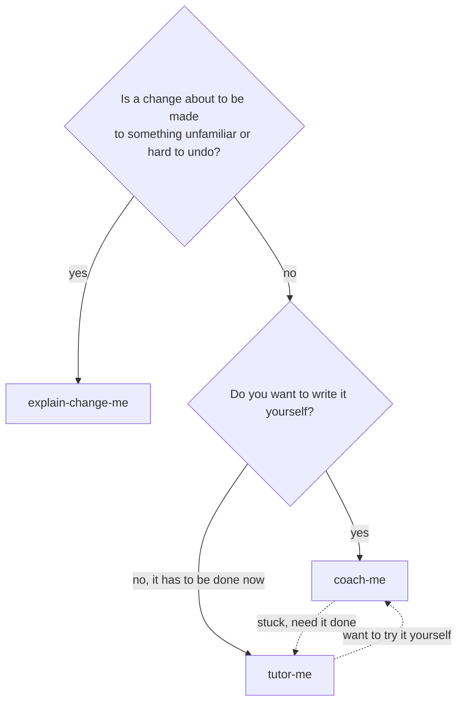

# upskill-me

Three agent skills that teach you while you do real engineering work.

Coding agents are good at handing you finished answers. That gets the ticket
closed and leaves you no better at the job: you forget the command, cannot
explain the change in review, and ask again next week. These skills change
what the agent hands back, so the work still gets done and you learn from it.

| Skill | Who does the work | You get | Pick it when |
|---|---|---|---|
| [`coach-me`](skills/coach-me/SKILL.md) | You | Hints and questions, one at a time, never the solution | You are doing the task and want to work it out yourself |
| [`tutor-me`](skills/tutor-me/SKILL.md) | You run it; the agent answers | The answer, how it works, the commands for you to type, how to find it next time | It has to be done today and you want to understand it |
| [`explain-change-me`](skills/explain-change-me/SKILL.md) | The agent, before anything changes | The mechanism, the settings, blast radius, rollback, a paragraph for colleagues | The change is unfamiliar or hard to undo, or you must defend it |

They are written for infrastructure and software engineers: the examples lean
towards Kubernetes, Terraform, Grafana, Go and Python, but the methods work for
any stack.

## Which one?



The skills hand over to each other: `coach-me` offers `tutor-me` when you ask
for the answer, `tutor-me` switches to `coach-me` when you want to write it
yourself, and both use `explain-change-me` for the full path of a mechanism.

### Examples

| Situation | Skill |
|---|---|
| Writing your first Helm chart and you want the practice | `/coach-me write a Helm chart for the API` |
| A failing test you want to debug yourself | `/coach-me` (troubleshoot mode) |
| Reviewing a colleague's Terraform MR and you want to spot what a lead would | `/coach-me review` |
| Fixing a production autoscaler today and you want to know why the fix works | `/tutor-me` |
| Changing node consolidation, and you must explain it in the change review | `explain-change-me` |

## What each skill does

**`coach-me`** classifies the request into one of nine modes (mechanism,
build, practice, troubleshoot, read, review, design, recall, explain) and
coaches with the smallest useful help: a question, then where to look, then
the concept by name, then an approach, then pseudocode. It does not write the
solution or edit your files. It finishes by asking you to explain why the
result works, with two quiz questions and primary sources to read next.

**`tutor-me`** gives the real answer in a fixed shape: what we are doing and
what good looks like, how it works underneath, the commands for you to run
(read-only first, with the undo for anything that changes state), and how to
look it up yourself next time. It asks for one prediction per reply and ends a
task with a recap and two quiz questions.

**`explain-change-me`** walks through a change before it is made: the
paragraph for colleagues, how the surrounding system works, the knobs and
their defaults, which layer enforces what, what happens at runtime, blast
radius, what a rollback does and does not undo, and the read-only commands
that show it.

`coach-me` and `tutor-me` are started by hand (`/coach-me`, `/tutor-me`).
`explain-change-me` is also picked up by the agent on its own when a change
touches a system you did not build or is hard to reverse.

## Install

**Claude Code**, as a plugin:

```sh
claude plugin marketplace add wojukasz/upskill-me
claude plugin install upskill-me@upskill-me
```

**Any agent that reads [Agent Skills](https://agentskills.io)**, with the
[skills CLI](https://www.skills.sh):

```sh
npx skills add wojukasz/upskill-me
```

**oh-my-pi**:

```sh
omp plugin marketplace add wojukasz/upskill-me
omp plugin install upskill-me@upskill-me
```

**By hand**: clone the repository and link each folder under `skills/` into
your agent's skills directory, for example `~/.claude/skills` or
`~/.agents/skills`.

```sh
git clone https://github.com/wojukasz/upskill-me ~/git/upskill-me
for s in ~/git/upskill-me/skills/*/; do ln -s "$s" ~/.claude/skills/; done
```

## Make it yours

All three skills read `~/.config/upskill-me/profile.md` before they start, if
it exists: what you work with daily, what you are learning, and what to skip.
Without it, the skill asks you once. Start from
[`examples/profile.md`](examples/profile.md):

```sh
mkdir -p ~/.config/upskill-me
cp examples/profile.md ~/.config/upskill-me/profile.md
```

Your own agent instructions (`AGENTS.md`, `CLAUDE.md`) still win on accuracy,
writing style and safety: the skills never change a live system without your
say-so.

## Compatibility

The skills follow the [Agent Skills specification](https://agentskills.io/specification).
`coach-me` and `tutor-me` also set `disable-model-invocation` and
`argument-hint`, which Claude Code and oh-my-pi use to run them only when you
type the command. Agents that ignore those fields may start them on their own;
the descriptions say "invoked by hand" to discourage that.

Check a skill against the specification (the two extra fields above are
reported and expected):

```sh
uvx --from skills-ref agentskills validate skills/explain-change-me
```

## Licence

[MIT](LICENSE).
